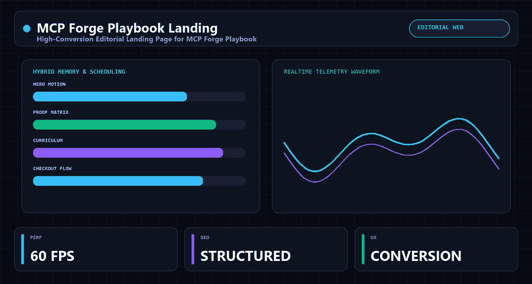

 

 

> **High-Conversion Editorial Landing Page for MCP Forge Playbook.**  
> Part of the **Benni Master OS** sovereign engineering ecosystem.

 

---

MCP Forge Operator Playbook — Premium guide to building MCP servers with mcp-forge. Powered by Benni-os.
